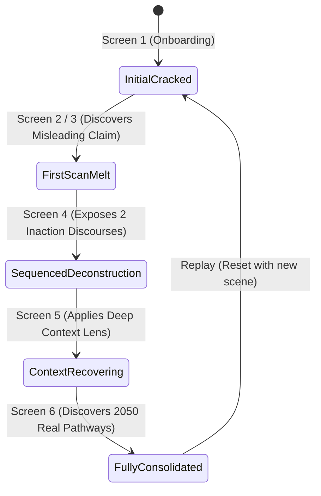
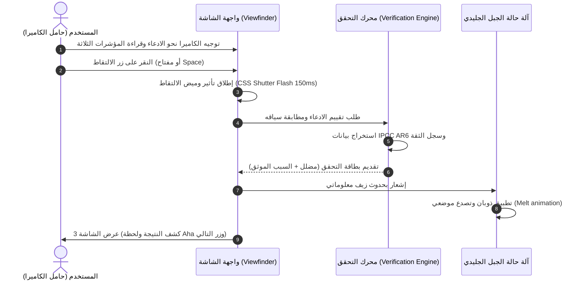
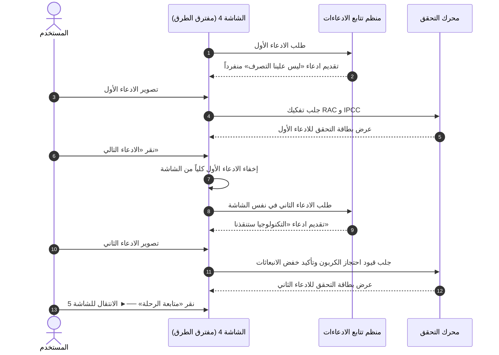

# كاميرا الحقيقة (Caméra de la Vérité / Vérité Climat)
## وثيقة التصور المعماري والتصميم التقني للنظام (System Architecture & Technical Design)
### النسخة: MVP 1.0 — وثيقة مرجعية شاملة

---

## فهرس المحتويات

1. [نظرة عامة على النظام (System Overview)](#1-نظرة-عامة-على-النظام-system-overview)
2. [المبادئ والقرارات المعمارية الحاكمة (Architectural Principles)](#2-المبادئ-والقرارات-المعمارية-الحاكمة-architectural-principles)
3. [الهندسة المعمارية في طبقات (Layered Architecture)](#3-الهندسة-المعمارية-في-طبقات-layered-architecture)
4. [هيكلية المشروع وحزمة الملفات (Project Directory Structure)](#4-هيكلية-المشروع-وحزمة-الملفات-project-directory-structure)
5. [أطراف النظام ونموذج الاستخدام (Actors & Persona Model)](#5-أطراف-النظام-ونموذج-الاستخدام-actors--persona-model)
6. [الوحدات الوظيفية للنظام (System Functional Modules)](#6-الوحدات-الوظيفية-للنظام-system-functional-modules)
7. [معمارية وهياكل البيانات (Data Architecture & Schemas)](#7-معمارية-وهياكل-البيانات-data-architecture--schemas)
8. [تدفق المستخدم وهندسة الشاشات (User Flow & Screen Architecture)](#8-تدفق-المستخدم-وهندسة-الشاشات-user-flow--screen-architecture)
9. [المكونات المشتركة العابرة للشاشات (Shared Core Components)](#9-المكونات-المشتركة-العابرة-للشاشات-shared-core-components)
10. [محرك حالة الجبل الجليدي (Iceberg State Machine)](#10-محرك-حالة-الجبل-الجليدي-iceberg-state-machine)
11. [إدارة الجلسة والتفاعل المحلي (State Management & Local Session)](#11-إدارة-الجلسة-والتفاعل-المحلي-state-management--local-session)
12. [الأمان وسلامة البيانات والمصادر (Security, Data Integrity & Privacy)](#12-الأمان-وسلامة-البيانات-والمصادر-security-data-integrity--privacy)
13. [متطلبات الأداء والوصولية وتجربة الاستخدام (Performance, NFRs & UX)](#13-متطلبات-الأداء-والوصولية-وتجربة-الاستخدام-performance-nfrs--ux)
14. [معمارية النشر والتشغيل (Deployment Architecture)](#14-معمارية-النشر-والتشغيل-deployment-architecture)
15. [مخططات التتابع التفاعلية (Sequence Diagrams)](#15-مخططات-التتابع-التفاعلية-sequence-diagrams)
16. [مصفوفة الامتثال للالتزامات والمصادر (Compliance & Constraints Matrix)](#16-مصفوفة-الامتثال-للالتزامات-والمصادر-compliance--constraints-matrix)
17. [الافتراضات التقنية والمسائل المفتوحة (Assumptions & Open Questions)](#17-الافتراضات-التقنية-والمسائل-المفتوحة-assumptions--open-questions)

---

## 1. نظرة عامة على النظام (System Overview)

### 1.1 تعريف النظام ورسالته
تطبيق **«كاميرا الحقيقة» (Caméra de la Vérité / Vérité Climat)** هو تطبيق ويب تفاعلي من نمط الصفحة الواحدة (Single Page Application - SPA)، صُمم خصيصاً لمساعدة الجمهور العام، حتى غير المتخصص ومن لا يملكون معرفة أولية بالتغير المناخي وحلوله، على التمييز الدقيق والمبسط بين الادعاءات الزائفة أو المضللة وبين الحلول المناخية الحقيقية والمثبتة علمياً.

### 1.2 الزاوية السردية (Narrative Angle)
يتجسد دور المستخدم في تجربة سردية بصرية مشوقة: المستخدم هو **«حامل الكاميرا» (Porteur de Caméra)** المتواجد فوق جبل جليدي متصدع؛ مهمته توجيه كاميرا تفاعلية (محاكاة بصرية كاملة دون تشغيل حساسات العتاد) نحو **ادعاء مكتوب واحد في كل مرة**، قراءة مؤشراته الأساسية الثلاثة (المصدر، الدليل، السياق) قبل التصوير، ثم النقر على زر الالتقاط لكشف التقييم الموثق (مدعوم / مضلل / يحتاج سياقاً) مع بيان السبب وسنده العلمي ومحدداته.

في أسفل واجهة الاستخدام، يتمركز عنصر **«الجبل الجليدي» (L'Iceberg)** التفاعلي؛ وهو ويدجت ديناميكي يعكس بصرياً **حالة المعلومات والمصداقية العلمية** (يذوب الجبل مع الادعاءات المضللة، ويتماسك ويتجمد مع الحقائق والحلول الموثقة والسياق المكتمل)، ولا يمثل قط الحالة الأخلاقية للمستخدم أو ذنبه الشخصي، بحيث يفهم المستخدم جوهر القضايا دون إشعاره بالذنب، ويكتشف في ختام التجربة أن مستقبلاً إيجابياً ومستداماً يقع في متناول اليد والعمل الجماعي والمؤسسي.

### 1.3 الجمهور المستهدف وتجربة الاستخدام
* **الجمهور**: عامة الناس والشباب والمهتمون دون الحاجة إلى خلفية في علوم الأرض أو الهندسة المناخية.
* **طبيعة الواجهة**: موجهة للهاتف أولاً (Mobile-first)، باللغة الفرنسية (لغة البيانات والتقارير المعتمدة من ADEME و IPCC وغيرها)، سريعة الإدراك (كل شاشة تُستوعب في أقل من 30 ثانية)، خالية من الازدحام والتعقيد الإجرائي.

### 1.4 المصادر المرجعية المعتمدة
يعتمد التطبيق حصرياً على شبكة المصادر الرسمية والعلمية الموثقة في وثيقة `Ressources.md`:
* **الهيئات العلمية والمؤسسية**: الهيئة الحكومية الدولية المعنية بتغير المناخ (IPCC - AR6)، الوكالة الفرنسية للتحول البيئي (ADEME)، بوابة البيانات المفتوحة (ADEME Open Data)، مسارات التحول (Transitions 2050)، المجلس الأعلى للمناخ بفرنسا (HCC).
* **المصادر التعليمية والإعلامية التفسيرية**: شبكة العمل المناخي (Réseau Action Climat - RAC)، المركز الوطني للتعليم عن بعد بفرنسا (CNED)، المنصة الإعلامية التحليلية (Bon Pote).
* **الأدوات والمحاكيات التفاعلية الاسترشادية**: محاكي البصمة الفردية (Nos Gestes Climat)، واجهة استرجاع النصوص (Climate Q&A).

---

## 2. المبادئ والقرارات المعمارية الحاكمة (Architectural Principles)

لتلبية متطلبات `cahier_charge.md` الصارمة، خصوصاً شرط **«قابلية التنفيذ الكامل في ليلة واحدة» (Exécutable en une nuit)** وبناء تجربة خفيفة وموثوقة بنسبة 100% دون نقاط إخفاق خارجية، تم اعتماد القرارات المعمارية التالية:

| المبدأ المعماري | القرار التقني | التبرير والمسوغ الهندسي |
| :--- | :--- | :--- |
| **تطبيق أحادي الصفحة خفيف (Lightweight SPA)** | استخدام واجهة ويب تفاعلية نقية (Vanilla TypeScript / React + Vite + Tailwind CSS) تعمل بالكامل في المتصفح | ضمان سرعة تحميل فائقة (< 1.5 ثانية)، بدون وميض، وبدون الحاجة لتهيئة خوادم معقدة. |
| **صفر خوادم وقت التشغيل (Zero-Runtime Backend)** | تخزين الادعاءات والمصادر والتقييمات مسبقاً في ملفات بيانات هيكلية محلية (`claims.json` / `sources.json`) | الالتزام الصارم بشرط: «لا APIs خارجية» لتفادي مشاكل الحصص (Rate limits) والـ CORS وتوقف الخدمات أثناء العرض. |
| **محاكاة بصرية نقية للكاميرا (Pure CSS/SVG Viewfinder)** | إنشاء إطار الكاميرا والمحدد البصري وشبكة التصوير بتأثيرات CSS و SVG | الالتزام الصارم بـ: «لن نستخدم كاميرا حقيقية (محاكاة بـ CSS فقط)»، وتجنب طلب أذونات كاميرا الهاتف والتعقيدات الأمنية. |
| **حظر الرسوميات الثقيلة (No Heavy WebGL)** | حركات CSS انتقالية بسيطة (Transitions Fade/Slide ≤ 300ms) وتفاعل SVG خفيف للجبل الجليدي | الالتزام بالشرط: «لن نستخدم WebGL أو تقنيات مستحيلة في ليلة واحدة»، وضمان تشغيل سلس 60fps على الهواتف الاقتصادية. |
| **عرض ادعاء واحد حصراً في أي لحظة (Single Claim Display)** | تصميم واجهات الشاشات ومحرك العرض لفرض قيد ظهور بطاقة ادعاء وحيدة فقط في أي شاشة أو لحظة | تنفيذ الالتزام الحاسم: «لن نعرض ادعاءين أو أكثر في نفس الشاشة أو في نفس اللحظة؛ سيُعرض ادعاء واحد فقط في كل مرة». |
| **استقلالية محرك الجبل الجليدي (Decoupled Iceberg State)** | آلة حالة حتمية (Finite State Machine) تدير ذوبان وتماسك الجبل بناءً على موثوقية المعلومة | تجسيد مبدأ: «الجبل يعكس حالة المعلومات لا حالة المستخدم»، وتجنب الرسائل الأخلاقية أو لوم المستخدم نهائياً. |
| **العمق المعرفي ثنائي الطبقة (Two-Tier Depth)** | طبقة عليا سريعة (مسح وتصوير واكتشاف كبسولي) + طبقة عميقة (بطاقة التحقق الرباعية والنوافذ التفسيرية للمصدر) | تلبية حاجة المستخدم العادي للسرعة والتشويق مع إتاحة التحقق العلمي الصارم والمحدد بالصفحات والدراسات للمدققين. |
| **قاعدة الحياد عند نقص الدليل (Evidence Fallback Rule)** | إرجاع نص قياسي محايد عند عدم كفاية الدليل: «لم نتمكن من التحقق من هذه الصياغة من المصادر المعروضة» | حظر إصدار أحكام إدانة مطلقة (كذب/خطأ) لمجرد غياب النص في مصادر العرض، احتراماً للمنهج العلمي و`Ressources.md`. |
| **عدم وجود نظام مستخدمين (Zero-Auth / Zero-PII)** | التطبيق مفتوح ومباشر للعموم، بدون تسجيل دخول، ولا حفظ لكوكيز تتبعية، ولا طلب بيانات شخصية | حماية الخصوصية المطلقة، وتبسيط تدفق المستخدم للبدء الفوري خلال ثوانٍ معدودة. |

---

## 3. الهندسة المعمارية في طبقات (Layered Architecture)

تم تنظيم النظام وفق معمارية عمودية نظيفة تفصل العرض عن منطق البيانات والمحاكاة:

```
┌────────────────────────────────────────────────────────────────────────┐
│                        PRESENTATION LAYER                              │
│  ┌──────────────────────────────────────────────────────────────────┐  │
│  │ Mobile-first Responsive Viewport (Max 3 interactive actions/scr) │  │
│  │ Screens: [1] Onboarding │ [2] Cam Scene 1 │ [3] Result Aha       │  │
│  │          [4] Crossroads │ [5] Deep Context│ [6] Climax / Cert    │  │
│  └──────────────────────────────────────────────────────────────────┘  │
│  ┌──────────────────────────────────────────────────────────────────┐  │
│  │ Shared UI: CSS Viewfinder Overlay │ Verification Card (4 Boxes)  │  │
│  │ Shared UI: Iceberg SVG Widget     │ OCR/Source Limits Disclaimer │  │
│  └──────────────────────────────────────────────────────────────────┘  │
├────────────────────────────────────────────────────────────────────────┤
│                   INTERACTION & SIMULATION LAYER                       │
│  ┌──────────────────────────────────────────────────────────────────┐  │
│  │ • Viewfinder Frame & Shutter Controller (CSS Touch/Click/Space)  │  │
│  │ • Context Lens Controller (Draggable Slider for nuances)         │  │
│  │ • Climax Pathway Simulation Controller (Transitions 2050 slider) │  │
│  │ • CSS Animation Engine (300ms Fade / Slide Transitions)          │  │
│  └──────────────────────────────────────────────────────────────────┘  │
├────────────────────────────────────────────────────────────────────────┤
│                     CORE DOMAIN & STATE LAYER                          │
│  ┌──────────────────────────────────────────────────────────────────┐  │
│  │ • Linear Navigation Controller (Screen 1 → 6, No free wander)    │  │
│  │ • Iceberg State Machine (Melts with Misinfo / Freezes with Truth)│  │
│  │ • Sequential Claim Manager (Strict single-claim queue for scr 4) │  │
│  │ • Certificate Generation Engine (Dynamic SVG/Canvas generation)  │  │
│  └──────────────────────────────────────────────────────────────────┘  │
├────────────────────────────────────────────────────────────────────────┤
│                 EVALUATION & DATA ACCESS LAYER (LOCAL)                 │
│  ┌──────────────────────────────────────────────────────────────────┐  │
│  │ • Static Data Repository (claims.json, sources.json, rules.json) │  │
│  │ • Fact-Checking Rules Matcher (Status: Supported/Misleading/Ctx) │  │
│  │ • Strict Fallback & Disclaimer Resolver (Evidence bounds check)  │  │
│  │ • Source Boundary Guardian (Enforces limits per IPCC/ADEME/RAC)  │  │
│  └──────────────────────────────────────────────────────────────────┘  │
└────────────────────────────────────────────────────────────────────────┘
```

---

## 4. هيكلية المشروع وحزمة الملفات (Project Directory Structure)

صُممت بنية المجلدات لتكون قياسية، قابلة للبناء الفوري والتشغيل الساكن، ومتوافقة تماماً مع معايير التسليم (`README.md` + `LICENSE` + مجلد `assets/`):

```text
ai-truth-camera/
├── index.html                       # نقطة الإطلاق الأساسية للتطبيق الأحادي (SPA)
├── package.json                     # إعدادات الحزم والاعتماديات الخفيفة
├── vite.config.ts                   # تكوين مجمّع البناء السريع Vite
├── tsconfig.json                    # إعدادات TypeScript الصارمة
├── README.md                        # دليل المشروع ودليل الاستخدام والتشغيل
├── LICENSE                          # رخصة حرة ومفتوحة المصدر (MIT License)
├── assets/                          # مجلد الوسائط والأصول الحرة المرخصة
│   ├── icons/                       # أيقونات واجهة المستخدم (كاميرا، سهم، عدسة، درع)
│   ├── fonts/                       # خطوط الطباعة المفتوحة المتوافقة
│   └── svg/                         # رسوميات المتجهات (طبقات الجبل الجليدي، الشهادة)
│       ├── iceberg-stable.svg       # حالة الجبل الجليدي المتماسك والصحي
│       ├── iceberg-melting.svg      # حالة الجبل الجليدي المتصدع والذائب
│       └── camera-overlay.svg       # إطار محدد الكاميرا المفرغ
├── src/
│   ├── main.ts                      # نقطة الدخول البرمجية وتهيئة التطبيق
│   ├── types/                       # تعريفات الأنواع البرمجية وهياكل البيانات
│   │   ├── claim.types.ts           # واجهات الادعاءات والمؤشرات والتقييمات
│   │   ├── source.types.ts          # واجهات المصادر العشرة وحدود كل منها
│   │   └── state.types.ts           # حالات الجبل الجليدي ومسار التنقل
│   ├── data/                        # البيانات الهيكلية المستخرجة من Ressources.md
│   │   ├── claims.json              # مصفوفة الادعاءات الخاصة بكل شاشة
│   │   ├── sources.json             # بيانات المصادر العشرة وتصنيفاتها وحدودها
│   │   └── transitions2050.json     # بيانات السيناريوهات الأربعة الاستشرافية لفرنسا
│   ├── core/                        # محركات المنطق الداخلي والحالة
│   │   ├── navigation.ts            # إدارة الانتقال الخطي الصارم بين الشاشات
│   │   ├── iceberg-fsm.ts           # آلة حالة الجبل الجليدي المنفصلة
│   │   ├── claim-engine.ts          # محرك استرجاع وعرض الادعاء الواحد
│   │   └── certificate.ts           # منطق توليد وتصدير شهادة حامل الكاميرا
│   ├── components/                  # المكونات المشتركة
│   │   ├── viewfinder.ts            # محدد الكاميرا المحاكى بـ CSS مع زر الالتقاط
│   │   ├── verification-card.ts     # بطاقة التحقق الرباعية (المصدر، الدليل، السياق، ما لا نعرفه)
│   │   ├── iceberg-widget.ts        # ويدجت الجبل الجليدي أسفل الشاشة
│   │   ├── indicators-bar.ts        # شريط المؤشرات الثلاثة (المصدر / الدليل / السياق)
│   │   └── ocr-disclaimer.ts        # مكوّن توضيح حدود OCR وتأكيد النص
│   ├── screens/                     # الشاشات الست وفق cahier_charge.md
│   │   ├── screen1-onboarding.ts    # شاشة البداية: التقط الكاميرا (15 ثانية)
│   │   ├── screen2-camera-first.ts  # شاشة الكاميرا: ادعاء الطاقات المتجددة
│   │   ├── screen3-result-first.ts  # شاشة النتيجة: أول كشف وحقيقة IPCC
│   │   ├── screen4-crossroads.ts    # شاشة مفترق الطرق: ادعاءان متتابعان (ادعاء واحد في كل مرة)
│   │   ├── screen5-context.ts       # شاشة السياق العميق: عدسة السيارات الكهربائية
│   │   └── screen6-climax.ts        # شاشة الذروة: محاكاة 2050 والتماسك والشهادة
│   └── styles/
│       ├── main.css                 # الأنماط العامة ونظام الألوان والطباعة
│       ├── camera.css               # أنماط ومؤثرات الكاميرا والمحدد البصري
│       └── iceberg.css              # أنماط ذوبان وتماسك الجبل الجليدي
```

---

## 5. أطراف النظام ونموذج الاستخدام (Actors & Persona Model)

بناءً على التزامات `cahier_charge.md`، النظام مبسط ومتحرر تماماً من أعباء إدارة الجلسات والمصادقة:

```
┌────────────────────────────────────────────────────────────────────────┐
│                        Le Porteur de Caméra                            │
│                 (حامل الكاميرا — المواطن والمستخدم العام)                  │
└────────────────────────────────────────────────────────────────────────┘
                                    │
                                    │ تفاعل بصري مباشر
                                    ▼
┌────────────────────────────────────────────────────────────────────────┐
│                 تطبيق «كاميرا الحقيقة» (Single Session)                 │
│  • لا يتطلب أي تسجيل دخول (No Login / No Sign-up)                      │
│  • لا توجد حسابات أو كلمات مرور أو رموز مشفرة (No Passwords / No JWT)   │
│  • لا توجد صلاحيات تفاضلية أو أدوار خلفية (No Admin / No Cashier)      │
│  • جميع المستخدمين يحصلون على نفس المسار الاستكشافي الموثق والشفاف       │
└────────────────────────────────────────────────────────────────────────┘
```

* **الطرف الفاعل**: المستخدم العام (Le Porteur de Caméra).
* **طريقة الوصول**: رابط مباشر عبر الويب، يعمل فوراً على أي متصفح هاتف ذكي أو حاسوب دون تنزيل أو تسجيل.
* **الهدف النفسي والمعرفي**: تحويل المستخدم من متلقٍ سلبي للادعاءات إلى باحث فضولي يدرك أهمية فحص المصدر ودرجة الثقة والسياق الزمني والجغرافي قبل تصديق أي خطاب مناخي.

---

## 6. الوحدات الوظيفية للنظام (System Functional Modules)

### 6.1 وحدة التحكم في التنقل الخطي (Linear Navigation Module)
* **المسؤولية**: فرض المسار الخطي الصارم المنصوص عليه في وثيقة الشروط (`Screen 1 → 2 → 3 → 4 → 5 → 6`).
* **القواعد الصارمة**:
  - منع التنقل الحر أو القوائم المنسدلة الجانبية أو التراجع العشوائي.
  - إتاحة زر واحد بارز ونظيف («التالي» أو «التقط الكاميرا») للانتقال التتابعي.
  - المسار الوحيد للعودة هو زر «إعادة اللعب» في الشاشة 6، والذي يعيد المستخدم إلى الشاشة 2 بمشهد جديد ومحتوى مدعوم.

### 6.2 وحدة محاكاة الكاميرا والمحدد البصري (Camera Simulation Module)
* **المسؤولية**: توفير إحساس بصري كامل بأن المستخدم يمسك كاميرا رقمية موجهة نحو ورقة ادعاء، دون تشغيل عتاد الكاميرا الفعلي.
* **العناصر التقنية**:
  - إطار محدد الرؤية (Viewfinder Reticle) مع خطوط توجيه في الأركان الأربعة وأيقونة تركيز بؤري وسطية.
  - زر التقاط تفاعلي (Shutter Button) بارز في أسفل الشاشة يدعم اللمس، النقر، ومفتاحي `Enter` و `Space`.
  - وميض بصري خفيف (Flash / Shutter Click Animation ≤ 150ms) عند الالتقاط قبل فتح نافذة التقييم.

### 6.3 وحدة استعراض الادعاء الفردي المتتابع (Sequential Single-Claim Engine)
* **المسؤولية**: تطبيق القاعدة الصارمة الحاكمة في التصميم: **«ادعاء واحد فقط في كل لحظة»**.
* **الآلية في الشاشة 4 (مفترق الطرق)**:
  - يُعرض الادعاء الأول («ليس علينا التصرف» / «Nous n'avons pas à agir») منفرداً في واجهة الكاميرا.
  - عند قيام المستخدم بتصويره وقراءة تقييمه، يُزال الادعاء الأول تماماً من الشاشة ويحل محله الادعاء الثاني («التكنولوجيا ستنقذنا» / «La technologie nous sauvera»).
  - لا يُعرض الادعاءان معاً في نفس الوقت، ولا يُمنح المستخدم خيار المفاضلة بينهما، بل يتم توجيهه لتفكيك الادعاءين بالتتابع المنطقي.

### 6.4 محرك بطاقة التحقق الرباعية (Verification Card Engine)
* **المسؤولية**: صياغة وتوليد بطاقة التحقق الرسمية المشتركة في الشاشات (2 إلى 6).
* **الهيكل الإلزامي للبطاقة (4 خانات محددة)**:
  1. **المصدر (Source)**: تحديد الجهة ونوعها (علمي/مؤسسي، تعليمي، أداة) وسنة النشر.
  2. **ما وجدناه (Ce que nous avons trouvé)**: نص الاقتباس الحرفي، الرقم المحدد، والرابط التوثيقي الأصلي.
  3. **السياق والقيود (Contexte et limites)**: النطاق الجغرافي (فرنسا / العالم)، السيناريو المستخدم، الفترة الزمنية، ودرجة عدم اليقين.
  4. **ما لا نعرفه (Ce que nous ne savons pas)**: ما لا يغطيه المصدر وما بقي غير محسوم علمياً دون افتراضات متعجرفة.
* **قاعدة Fallback الأساسية**: عند فحص ادعاء لا يتوفر له دليل كافٍ ومطابق في مصادر العرض المتاحة، يُرجع المحرك حكماً ثابتاً: «لم نتمكن من التحقق من هذه الصياغة من المصادر المعروضة»، ويحظر النظام وصف الادعاء بأنه «كذب» أو «خطأ» في هذه الحالة.

### 6.5 وحدة توضيح حدود التعرف البصري (OCR & Recognition Limits Module)
* **المسؤولية**: تجسيد مبدأ الشفافية التقنية المنصوص عليه في `Ressources.md`.
* **الوظائف**:
  - تنبيه المستخدم دائماً بأن مطابقة النص أو عدم العثور عليه لا يعنيان بذاتهما إثبات صحة الادعاء أو كذبه علمياً.
  - إظهار شريط نصي قابل للتأكيد يوضح حدود التعرف البصري ويطلب من المستخدم اعتماد صياغة النص عند الشك في دقة القراءة.

### 6.6 محرك محاكاة الجبل الجليدي (Iceberg State Machine)
* **المسؤولية**: إدارة الحالة البصرية للجبل الجليدي أسفل الشاشة بما يعكس مستوى جودة المعلومات والتسليح العلمي للمستخدم.
* **القواعد**:
  - يتفاعل الجبل مع تصوير الادعاءات: يذوب وتتساقط أجزاؤه مع تزييف الحقائق، ويتماسك وتلتحم شقوقه مع الحقائق المثبتة والسياق المكتمل.
  - فصل تام بين الجبل واللوم الأخلاقي: لا رسائل إدانة للمستخدم؛ الجبل يعكس واقع المعرفة الكوكبية فقط.

### 6.7 وحدة محاكاة مسارات التحول وتوليد الشهادة (Climax & Certificate Module)
* **المسؤولية**: إدارة التفاعل في الشاشة 6 (الذروة والختام).
* **الوظائف**:
  - شريط تمرير تفاعلي يستعرض مسارات فرنسا الأربعة للوصول إلى الحياد الكربوني في 2050 بناءً على دراسة `Transitions 2050` لوكالة ADEME، مع إبراز الافتراضات ونوع النموذج دون تقديمه كتنبؤ حتمي.
  - إبراز تماسك الجبل الجليدي كدلالة على أن الحلول المنظمة والسياسات العامة الجماعية قادرة على حماية المستقبل.
  - توليد بطاقة رقمية ختامية باسم «شهادة حامل الكاميرا» (Certificat de Porteur de Caméra) قابلة للمشاركة أو الحفظ.

---

## 7. معمارية وهياكل البيانات (Data Architecture & Schemas)

تعتمد البنية على بيانات JSON منسقة مسبقاً، تخضع لمخططات قياسية وصارمة تعكس بدقة متطلبات `cahier_charge.md` وتصنيفات `Ressources.md`.

### 7.1 نموذج الادعاء (Claim Schema)

```typescript
export type EvaluationResult = 'soutenu' | 'trompeur' | 'necessite_contexte' | 'non_verifie';

export type ClaimCategory = 
  | 'observation_historique' 
  | 'projection_conditionnelle' 
  | 'option_attenuation' 
  | 'option_adaptation';

export interface Indicator {
  title: string;       // اسم المؤشر (Source, Preuve, Contexte)
  hint: string;        // التلميح الذي يقرأه المستخدم في الكاميرا قبل التصوير
  status: 'green' | 'yellow' | 'red';
}

export interface VerificationCardData {
  sourceName: string;          // اسم الجهة (مثل IPCC, ADEME, HCC)
  sourceType: 'scientifique_institutionnel' | 'pedagogique_mediatique' | 'outil_interactif';
  sourceDate: string;          // تاريخ المصدر بدقة (مثل AR6 2023, Rapport HCC 2026)
  whatWeFound: {
    quoteOrValue: string;      // الاقتباس أو القيمة الرقمية المحددة
    pageOrSection: string;     // الصفحة أو الفصل أو الدراسة المحددة
    sourceUrl: string;         // الرابط الأصلي المعتمد في Ressources.md
  };
  contextAndLimits: {
    period: string;            // الفترة الزمنية (مثل 2010-2019)
    geographicScope: string;   // النطاق الجغرافي (France, Global)
    scenario: string;          // السيناريو والافتراضات (SSP2-4.5, Net Zero 2050)
    confidenceLevel: string;   // درجة الثقة أو عدم اليقين (High Confidence, Estimation)
  };
  whatWeDoNotKnow: string;     // ما لا يعرفه أو ما لا يغطيه المصدر صراحة
  neutralFallbackUsed: boolean; // هل تم تفعيل رسالة الفشل المحايد؟
}

export interface Claim {
  id: string;                  // معرف الادعاء (مثل c-renewables-01)
  screenId: number;            // الشاشة المخصصة له (2, 4, 5)
  sequenceOrder?: number;      // ترتيب الظهور في الشاشة 4 (1 ثم 2)
  rawText: string;             // نص الادعاء المعروض بالفرنسية
  category: ClaimCategory;     // تصنيف الادعاء العلمي
  indicators: {
    sourceIndicator: Indicator;
    evidenceIndicator: Indicator;
    contextIndicator: Indicator;
  };
  evaluation: EvaluationResult;// التقييم النهائي
  ahaExplanation: string;      // شرح كشف النتيجة ولحظة Aha
  actionablePositiveInsight: string; // الخيار العملي الإيجابي والحل المتاح
  verificationCard: VerificationCardData;
}
```

### 7.2 نموذج المصدر ومحدداته (Source Boundary Schema)

```typescript
export interface SourceDefinition {
  id: string;                  // المعرف (ipcc, ademe, ademe_data, transitions2050, rac_urgence, rac_solutions, ngc, climate_qa, hcc, cned, bon_pote)
  officialName: string;        // الاسم الرسمي
  category: 'institutionnel' | 'scientifique' | 'pedagogique' | 'interactif' | 'mediatique';
  allowedRoles: string[];      // الأدوار المصرح بها وفق Ressources.md
  forbiddenUses: string[];     // المحاذير الصارمة والحدود
  primaryUrl: string;          // الرابط الرسمي
}
```

### 7.3 نموذج حالة الجبل الجليدي (Iceberg State Schema)

```typescript
export interface IcebergState {
  meltIndex: number;           // مؤشر من 0 (متماسك كلياً) إلى 100 (ذائب متصدع)
  visualStage: 'critical_melt' | 'moderate_melt' | 'recovering' | 'solid_consolidated';
  statusMessageFr: string;     // التوصيف البصري لحالة المعلومات
  ariaLiveMessage: string;     // الرسالة الصوتية للمعينات البصرية
}
```

---

## 8. تدفق المستخدم وهندسة الشاشات (User Flow & Screen Architecture)

يلتزم التطبيق بخريطة التدفق الخطي المحددة في `cahier_charge.md`، مع بقاء ادعاء واحد حصراً في الواجهة في أي لحظة:

```
[الشاشة 1: البداية (Onboarding)]
       │
       │ نقر على «التقط الكاميرا» (Prendre la caméra)
       ▼
[الشاشة 2: الكاميرا — المشهد الأول]
 (ادعاء واحد: «الطاقات المتجددة لا تنفع» + 3 مؤشرات)
       │
       │ توجيه + نقر تصوير (Capture)
       ▼
[الشاشة 3: النتيجة — أول كشف (لحظة Aha)]
 (كشف تقييم «مضلل» + السبب وسند IPCC + بطاقة التحقق)
       │
       │ نقر على «التالي» (Suivant)
       ▼
[الشاشة 4: مفترق الطرق — ادعاء واحد متتابع]
 (تصوير ادعاء «ليس علينا التصرف» ──► استبداله في نفس الشاشة بادعاء «التكنولوجيا ستنقذنا» ──► تصويره)
       │
       │ اكتمال تصوير الادعاءين بالتتابع
       ▼
[الشاشة 5: السياق — الطبقة العميقة]
 (سحب عدسة السياق + تصوير ادعاء السيارات الكهربائية ──► كشف «يحتاج سياقاً»)
       │
       │ نقر على «التالي» (Suivant)
       ▼
[الشاشة 6: الذروة والختام]
 (محاكاة مسارات 2050 + تماسك الجبل + استلام شهادة حامل الكاميرا)
       │
       └─── زر «إعادة اللعب» (Rejouer) ──► العودة إلى [الشاشة 2] بمشهد جديد
```

### 8.1 الشاشة 1 — البداية (Onboarding)
* **الهدف**: يفهم المستخدم في 15 ثانية أنه «حامل كاميرا» يقف على جبل جليدي متصدع، ومهمته فحص الادعاءات وكشف التضليل لإنقاذ الجبل واستعادة استقراره.
* **عناصر الواجهة (بحد أقصى 3 عناصر تفاعلية)**:
  1. عنوان سردي واضح مع رسم تعبيري للجبل الجليدي المتصدع.
  2. نص توجيهي موجز (أقل من 30 ثانية قراءة).
  3. زر تفاعلي وحيد بارز: «التقط الكاميرا» (`Prendre la caméra`).
* **الانتقال**: نقر الزر ينقل فوراً إلى الشاشة 2 بتأثير سلاسة (300ms fade).
* **المصدر المرتبط**: شاشة تعريفية لا ترتبط بمصدر خارجي.

### 8.2 الشاشة 2 — الكاميرا: المشهد الأول (Premier Cadrage)
* **الهدف**: يوجّه المستخدم الكاميرا نحو الادعاء الأول («الطاقات المتجددة لا تنفع» / « Les énergies renouvelables ne servent à rien »)، يقرأ المؤشرات الثلاثة الظاهرة في إطار الكاميرا (مؤشر المصدر، مؤشر الدليل، مؤشر السياق)، ثم يلتقط الصورة.
* **عناصر الواجهة (≤ 3 عناصر)**:
  1. إطار محدد الكاميرا المفرغ بتنسيق CSS/SVG يحيط بنص الادعاء الوحيد.
  2. شريط المؤشرات التمهيدية الثلاثة (Source / Preuve / Contexte).
  3. زر الالتقاط (Shutter button) أسفل الواجهة (مع دعم مسافة/إدخال).
* **الانتقال**: يؤدي النقر على زر الالتقاط إلى فتح نافذة النتيجة كطبقة فورية والانتقال إلى الشاشة 3.
* **المصادر المرتبطة**: الهيئة الدولية IPCC (تقرير التقييم السادس AR6 وموجز صانعي السياسات لتبيان تراجع كلفة الطاقة المتجددة ومساهمتها الفعالة في التخفيف)، مع الاستئناس ببيانات ADEME للسياق الفرنسي.

### 8.3 الشاشة 3 — النتيجة: أول كشف (Révélation & Moment Aha)
* **الهدف**: يكتشف المستخدم التقييم العلمي الصريح («مضلل» / « Trompeur ») والسبب المقترن ببيانات التقييم المجمع، فيدرك أن المؤشرات التمهيدية في الشاشة السابقة كانت تدله مسبقاً على الحقيقة (لحظة الوعي Aha).
* **عناصر الواجهة (≤ 3 عناصر)**:
  1. شارة التقييم بلون أحمر تحذيري خفيف (« Trompeur ») مع رسالة تفسيرية إيجابية غير لائمة.
  2. بطاقة التحقق المدمجة (أربع خانات: المصدر، ما وجدناه، السياق والقيود، ما لا نعرفه).
  3. زر وحيد للانتقال: «التالي» (`Suivant`).
* **تحديث الجبل الجليدي**: يظهر الجبل الجليدي أسفل الشاشة استجابة لتصوير الزيف عبر وميض ذوبان طفيف لتوضيح الارتباط بين جودة المعلومة وسلامة الكوكب.
* **الانتقال**: نقر زر «التالي» ينقل إلى الشاشة 4.
* **المصادر المرتبطة**: IPCC AR6 مع تفصيل درجة الثقة العالية (High confidence) ونوع الادعاء كخيار تخفيف مثبت.

### 8.4 الشاشة 4 — مفترق الطرق: ادعاء واحد متتابع (Carrefour Séquentiel)
* **الهدف**: يواجه المستخدم نمطين شائعين من خطابات التقاعس المناخي دون إرباكه بتعدد الخيارات؛ حيث يُعرض ادعاء واحد في كل مرة بالتتابع الصارم.
* **التدفق التتابعي الإلزامي داخل الشاشة**:
  - **الخطوة أ**: يظهر ادعاء «ليس علينا التصرف» (« Nous n'avons pas à agir »). يقرأ المستخدم مؤشراته ويصوره. تُعرض نتيجة تقييمه المضلل وتفكيكه استناداً لمقال حلول التخفيف لشبكة Réseau Action Climat و IPCC.
  - **الخطوة ب**: يختفي الادعاء الأول تماماً ليظهر في نفس موضع الشاشة الادعاء الثاني: «التكنولوجيا ستنقذنا» (« La technologie nous sauvera »). يصوره المستخدم ليكشف أن التعويل المطلق على التكنولوجيا دون خفض الانبعاثات الحقيقي هو رهان غير مضمون علمياً.
  - **قاعدة منع الازدحام**: لا يُعرض الادعاءان معاً في الواجهة في نفس اللحظة مطلقاً، ولا توجد قائمة اختيار.
* **عناصر الواجهة (≤ 3 عناصر في أي خطوة)**:
  1. محدد الكاميرا الحاضن للادعاء النشط حالياً.
  2. شريط المؤشرات التوجيهية للادعاء المعروض.
  3. زر الالتقاط (أثناء التصوير) / زر «الادعاء التالي» أو «متابعة الرحلة».
* **الانتقال**: بعد استكمال تصوير وتفكيك الادعاء الثاني، يؤدي الزر مباشرة إلى الشاشة 5.
* **المصادر المرتبطة**: Réseau Action Climat (مقال حلول التخفيف لعام 2022 المرتبط بـ AR6 للتنبيه بأن إزالة الكربون لا تعوض خفض الانبعاثات) مع تمييز مقترحات الشبكة السياسية عن خلاصات IPCC العلمية المحايدة.

### 8.5 الشاشة 5 — السياق: الطبقة العميقة (Lentille de Contexte)
* **الهدف**: يكتشف المستخدم أن تقييم الحقائق المناخية ليس دائماً أبيض أو أسود، بل هناك ادعاءات «تحتاج سياقاً» (« Nécessite du contexte ») مثل الجدل حول السيارات الكهربائية، ويتعلم مراعاة أبعاد العدالة الاجتماعية والبنية التحتية.
* **عناصر الواجهة (≤ 3 عناصر)**:
  1. ادعاء مفرد في الكاميرا (« Les voitures électriques polluent plus que le thermique »).
  2. أداة تفاعلية فريدة: **عدسة السياق (Curseur de Contexte)** — شريط سحب ينزلق ليكشف الطبقات المستترة (دورة حياة البطارية، مزيج الكهرباء الفرنسي، والعدالة الاجتماعية).
  3. زر الالتقاط المصحوب بالسياق (`Capturer avec contexte`).
* **بطاقة التحقق في الشاشة 5**: تعرض تصنيف «يحتاج سياقاً»، موضحة بالأرقام المنهجية (استناداً إلى ADEME و HCC) أن انبعاثات السيارة الكهربائية في فرنسا تنخفض بنسبة تقارب 60% إلى 70% على مدار دورة الحياة مقارنة بالحرارية بفضل المزيج الكهربائي منخفض الكربون، مع التنويه بضرورة دعم النقل العام وعدم معاقبة الفئات الأقل دخلاً في المناطق الريفية.
* **الانتقال**: نقر زر المتابعة ينقل إلى الشاشة 6.
* **المصادر المرتبطة**: ADEME (تحليلات دورة الحياة للسيارات)، HCC (التمييز المنهجي بين الانبعاثات الإقليمية والبصمة الكربونية المستوردة)، Nos Gestes Climat (كأداة تقديرية غير ملزمة)، مع تجنب لوم الأفراد.

### 8.6 الشاشة 6 — الذروة والختام (Climax & Dénouement)
* **الهدف**: يدرك المستخدم أن الحلول الفعالة والمجدية موجودة بالفعل ومثبتة علمياً، فيشهد تماسك الجبل الجليدي وتصلبه بصرياً، ويحصل على شهادة تقديرية تكرس دوره كـ «حامل كاميرا» واعي.
* **عناصر الواجهة (≤ 3 عناصر)**:
  1. شريط محاكاة تفاعلي يستعرض مسارات فرنسا الأربعة لعام 2050 (`Transitions 2050 - ADEME`: الجيل الرصين، التعاون الإقليمي، التقنيات الخضراء، الرهان التكنولوجي) مبيناً افتراضات كل مسار وسياقه الاستشرافي.
  2. رسم الجبل الجليدي المكتمل والصلب مع تأثير لمعان جليدي خفيف.
  3. زر إصدار ومشاركة «شهادة حامل الكاميرا» (`Partager mon certificat`) مع زر «إعادة اللعب بمشهد جديد» (`Rejouer`).
* **الانتقال**: زر «إعادة اللعب» يعيد المستخدم مباشرة إلى الشاشة 2 مع تفعيل حزمة ادعاءات ثانوية بديلة من ملف `claims.json`.
* **المصادر المرتبطة**: Transitions 2050 (عرض المسارات الأربعة كخيارات مستقبلية لا كحقائق راهنة مؤكدة)، CNED (شروحات التثقيف)، Bon Pote (أنماط الحجج كأداة استيضاح لا كحكم تكذيب)، Climate Q&A (كنموذج استرجاع نصوص مع التحفظات).

---

## 9. المكونات المشتركة العابرة للشاشات (Shared Core Components)

### 9.1 بطاقة التحقق الرباعية القياسية (Standard 4-Box Verification Card)
تُمثل هذه البطاقة القلب المعرفي للتحقق في التطبيق وتظهر في الشاشات (2، 3، 4، 5، 6). تتألف البطاقة من تخطيط شبكي (Grid) واضح ومقروء على شاشات الهواتف المحمولة يضم أربع خانات ثابتة:

```
┌────────────────────────────────────────────────────────────────────────┐
│                   BÂTONNET DE VÉRIFICATION CLIMAT                      │
├──────────────────────────────────┬─────────────────────────────────────┤
│ 1. LA SOURCE (المصدر)             │ 2. CE QUE NOUS AVONS TROUVÉ (ما وجدناه)│
│ • الهيئة: IPCC (Groupe III)      │ • الاقتباس: انخفاض تكلفة الطاقة      │
│ • النوع: تقييم علمي مؤسسي مجمّع   │   الشمسية بنسبة 85% بين 2010 و 2019 │
│ • الوثيقة والتاريخ: AR6 (2022)   │ • السند: SPM.C.4 / Rapport Technique│
│                                  │ • الرابط الموثق: ipcc.ch            │
├──────────────────────────────────┼─────────────────────────────────────┤
│ 3. CONTEXTE & LIMITES (السياق)   │ 4. CE QUE NOUS NE SAVONS PAS        │
│ • النطاق: عالمي (Moyenne globale)│ • لا تحسم هذه البيانات التحديات     │
│ • السيناريو: مسارات التخفيف السريع│   المحلية الفورية لشبكات التوزيع في │
│ • درجة الثقة: ثقة عالية جداً     │   كل قرية أو إقليم بعينه دون دراسة │
│   (Very High Confidence)         │   طبوغرافية مستقلة.                 │
└──────────────────────────────────┴─────────────────────────────────────┘
```

* **خوارزمية التعامل مع نقص الأدلة (Neutral Fallback Rule)**:
  إذا صادف النظام صياغة ادعاء تفتقر لدراسة مباشرة أو كان النص غير مغطى بالكامل في المصادر العشرة المنشورة في `Ressources.md`، يتم تلقائياً قفل البطاقة على النتيجة المحايدة التالية:
  > **«لم نتمكن من التحقق من هذه الصياغة من المصادر المعروضة»**  
  > *(Nous n'avons pas pu vérifier cette formulation à partir des sources présentées)*  
  ويُمنع المحرك قطعياً من إطلاق وصف «مكذوب»، «خاطئ»، أو «زائف» في غياب الدليل الدامغ.

### 9.2 مكوّن توضيح حدود التعرف البصري والـ OCR (OCR & Recognition Disclaimer)
مكوّن توعوي عابر يظهر أسفل محدد الكاميرا:
* **التنبيه المعرفي**: «التعرف البصري ومطابقة الكلمات هي أدوات مساعدة وليست دليلاً قاطعاً على صحة أو زيف المحتوى».
* **آلية التثبت**: يتيح المكون للمستخدم نقر زر «تأكيد النص» (`Confirmer le texte`) إذا ظهرت أي حروف غير مكتملة في صياغة الادعاء المحاكى قبل الانتقال لاعتماد نتيجة التقييم.

### 9.3 محدد الكاميرا البصري (Viewfinder Reticle Component)
* مكوّن مبني بـ CSS النقي يشتمل على:
  - أربع زوايا تركيز بصرية باللون الأبيض الشفاف (`rgba(255, 255, 255, 0.7)`).
  - نقطة تنشيط مركزية تفاعلية تتوهج عند النقر.
  - محاكاة خط أفق توازني رفيع يعزز إحساس التصوير الميداني للمناخ.

---

## 10. محرك حالة الجبل الجليدي (Iceberg State Machine)

الجبل الجليدي هو المرآة الرمزية لوعي النظام. صُممت آلة حالته لتكون مفصولة ومستقلة:



### 10.1 محددات الحالة وانتقالاتها

| الحالة البرمجية | مؤشر الذوبان (0 - 100) | المظهر البصري لطبقات SVG | الرسالة التفسيرية (الحيادية) |
| :--- | :--- | :--- | :--- |
| `initial_cracked` | 50% | جبل أبيض مزرق مع صدوع سطحية دقيقة | «الجبل متأثر بتضارب المعلومات غير الدقيقة» |
| `first_scan_melt` | 75% | انفصال كتلة جليدية صغيرة وتوهج أحمر خفيف | «الادعاء المضلل يغذي غياب الفهم العلمي السليم» |
| `sequenced_melt` | 65% | تراجع الصدع مع تفكيك خطاب التقاعس | «تفكيك حجج التقاعس يعيد التوازن لمشهد الحلول» |
| `context_recovering` | 35% | التحام الصدوع وتوهج فيروزي هادئ | «إدراك السياق والعدالة الاجتماعية يدعم التماسك» |
| `fully_consolidated` | 0% | جبل جليدي صلب وضخم تحيط به مياه مستقرة | «الحلول المناخية الحقيقية تحمي مستقبل الكوكب» |

### 10.2 مبدأ الفصل عن لوم المستخدم (No-Guilt Guarantee)
* لا تتغير حالة الجبل إطلاقاً بناءً على أي اختيارات شخصية أو استبيانات نمط حياة المستخدم.
* الانتقال بين الحالات يحدث كدلالة على **كشف الحقيقة وتثقيف المشهد المعلوماتي**.
* زر التقدم «التالي» يظل متاحاً ومفعلاً دائماً بغض النظر عن النتيجة، ولا توجد شروط عقابية أو حجب للمسار.

---

## 11. إدارة الجلسة والتفاعل المحلي (State Management & Local Session)

نظراً لعدم وجود خادم خلفي، تُدار بيانات الجلسة بالكامل داخل ذاكرة التطبيق (In-Memory Store) مع تخزين محلي اختياري خفيف (`localStorage`) لتأمين استمرارية الشاشة عند إعادة تحميل الصفحة:

```typescript
export interface AppSessionState {
  currentScreenId: number;        // من 1 إلى 6
  screen4Step: 'first' | 'second';// لإدارة التتابع الصارم في الشاشة 4
  activeClaimId: string;          // الادعاء المعروض حالياً
  icebergIndex: number;           // مؤشر الجبل الحالي
  contextLensExpanded: boolean;   // حالة فتح عدسة السياق في الشاشة 5
  simulation2050Scenario: string; // السيناريو المختار في الشاشة 6
  capturedClaimIds: string[];     // سجل الادعاءات التي تم تصويرها
  isReplaySession: boolean;       // هل الجلسة إعادة تشغيل بمشهد جديد؟
}
```

* **التنظيف الذاتي**: تُعاد تهيئة الجلسة بالكامل عند النقر على «إعادة اللعب»، مع توليد معرف جلسة جديد في الذاكرة لضمان تجربة متجددة وسلسة.

---

## 12. الأمان وسلامة البيانات والمصادر (Security, Data Integrity & Privacy)

### 12.1 حماية الخصوصية المطلقة (Privacy by Design)
* **انعدام التعقب**: لا يحتوي التطبيق على أي مكتبات تعقب خارجية أو كوكيز إعلانية (Zero Third-Party Trackers).
* **عدم جمع الهويات الشخصية (Zero PII)**: لا يطلب التطبيق أسماء أو إيميلات أو أرقام هواتف أو مواقع جغرافية، بما يتوافق 100% مع تشريعات RGPD الأوروبية.
* **الأمان المحلي**: كافة العمليات وحسابات المحاكاة وتوليد الشهادة تتم محلياً داخل معالج المتصفح (Client-side Execution).

### 12.2 سلامة الإسناد المصدري (Source Attribution Integrity)
لمنع أي تضليل أو خلط في البيانات العلمية، يفرض النظام القيود البرمجية التالية المستقاة من `Ressources.md`:
* **قيد IPCC**: إقران أي رقم أو سيناريو بدرجة الثقة والفترة الزمنية؛ الأرقام المرتبطة بتعهدات ما قبل مؤتمر COP26 تُعرض مؤرخة بوضوح ولا تُقدم كحصيلة راهنة.
* **قيد ADEME**: منع تعميم المؤشرات أو أرقام البصمة الفرنسية على المستوى العالمي؛ حظر عزو أي نتيجة لـ ADEME دون تحديد المرجع والصفحة.
* **قيد Transitions 2050**: عرض السيناريوهات الأربعة كنماذج استشرافية مشروطة بفرضيات محددة، وحظر تقديمها كقياس حالي أو تنبؤ حتمي.
* **قيد المنظمات المناصرة (Réseau Action Climat & Bon Pote)**: التمييز الصريح بين الخلاصات العلمية المجمعة وبين التوصيات والمواقف السياسية للمنظمات؛ حظر استخدام بطاقات حجج التقاعس لـ Bon Pote للحكم القطعي بكذب الادعاء.
* **قيد الأدوات التفاعلية (Nos Gestes Climat & Climate Q&A)**: عرض نتائج محاكي البصمة كتقدير استرشادي يتأثر بالفرضيات لا كقياس معملي دقيق؛ وعرض Climate Q&A كنموذج استرجاع فقرات يتطلب فحص النص الأصلي لا كقاضٍ آلي.

---

## 13. متطلبات الأداء والوصولية وتجربة الاستخدام (Performance, NFRs & UX)

تطبيقاً لبنود الفصل 4 من `cahier_charge.md`:

```
┌────────────────────────────────────────────────────────────────────────┐
│                   PERFORMANCE & ACCESSIBILITY MATRIX                   │
├──────────────────────────┬─────────────────────────────────────────────┤
│ المعيار غير الوظيفي      │ المستهدف الهندسي والآلية المحققة              │
├──────────────────────────┼─────────────────────────────────────────────┤
│ سرعة التحميل الأولية     │ < 1.5 ثانية عبر شبكات 4G (حزمة كود < 150KB) │
├──────────────────────────┼─────────────────────────────────────────────┤
│ زمن استجابة التفاعل      │ < 50ms لكل لمسة وزر؛ انتقال شاشات في 300ms  │
├──────────────────────────┼─────────────────────────────────────────────┤
│ سرعة الاستيعاب الذهني   │ استيعاب مضمون كل شاشة في أقل من 30 ثانية     │
├──────────────────────────┼─────────────────────────────────────────────┤
│ الحد الأقصى للتفاعلات    │ لا يزيد عدد العناصر التفاعلية عن 3 في أي شاشة│
├──────────────────────────┼─────────────────────────────────────────────┤
│ الاتساق البصري ولوحة الألوان│ أزرق جليدي وأبيض (#E0F2FE, #FFFFFF) للجبل، │
│                          │ أحمر تحذيري خفيف (#EF4444) للزيف،           │
│                          │ وأخضر زمردي هادئ (#10B981) للتماسك والحقيقة  │
├──────────────────────────┼─────────────────────────────────────────────┤
│ سهولة الوصول (A11y)      │ تباين ألوان WCAG AA، دعم أزرار Space/Enter  │
│                          │ للتصوير، وتسميات كاملة لقارئات الشاشة Aria  │
└──────────────────────────┴─────────────────────────────────────────────┘
```

---

## 14. معمارية النشر والتشغيل (Deployment Architecture)

نظراً لطبيعة المشروع كـ SPA خفيف ومستقل بدون خوادم، فإن هيكل النشر السحابي فائق البساطة والموثوقية:

```
┌────────────────────────────────────────────────────────────────────────┐
│                         DEVELOPER WORKSPACE                            │
│                 Git Repository (Code, JSON, Assets)                    │
└──────────────────────────────────┬─────────────────────────────────────┘
                                   │
                                   │ Build (Vite / Static HTML+TS)
                                   ▼
┌────────────────────────────────────────────────────────────────────────┐
│                         STATIC ASSET BUNDLE                            │
│                /dist (index.html, styles.css, app.js, /assets)         │
└──────────────────────────────────┬─────────────────────────────────────┘
                                   │
                                   │ Continuous Deployment (Git Push)
                                   ▼
┌────────────────────────────────────────────────────────────────────────┐
│                       GLOBAL CDN & HOSTING EDGE                        │
│            (GitHub Pages / Vercel / Netlify / Cloudflare Pages)        │
│  • استضافة ثابتة 100% مع شهادة SSL مجانية (HTTPS إلزامي)               │
│  • استجابة فورية من خوادم الحافة (Edge CDN Caching)                     │
│  • توافرية 99.99% بدون أي مصاريف تشغيلية أو قواعد بيانات                │
└────────────────────────────────────────────────────────────────────────┘
```

* **متغيرات البيئة**: لا توجد متغيرات بيئة سرية أو مفاتيح تشغيل مطلوبة في الواجهة؛ التطبيق مؤهل للعمل الفوري بمجرد رفع مجلد المخرجات على أي استضافة ثابتة.

---

## 15. مخططات التتابع التفاعلية (Sequence Diagrams)

### 15.1 مخطط التفاعل للشاشتين 2 و 3 (التوجيه، الالتقاط، ولحظة Aha)



### 15.2 مخطط التفاعل للشاشة 4 (الادعاء الواحد المتتابع)



---

## 16. مصفوفة الامتثال للالتزامات والمصادر (Compliance & Constraints Matrix)

### 16.1 مصفوفة الامتثال لـ `cahier_charge.md`

| البند / الالتزام المطلوب | الموضع في المعمارية | حالة الامتثال |
| :--- | :--- | :--- |
| **الشاشات الست وتدفقها الخطي** | الأقسام 6.1 و 8 (شاشات 1 إلى 6 بزر تقدم وحيد) | ✅ متطابق تماماً |
| **ادعاء واحد فقط في كل لحظة** | الأقسام 2، 6.3، 8.4 (منع الازدحام والتتابع الفردي) | ✅ متطابق تماماً |
| **محاكاة الكاميرا بـ CSS دون عتاد** | الأقسام 2، 6.2، 9.3 (محدد CSS/SVG بدون أذونات) | ✅ متطابق تماماً |
| **عدم استخدام WebGL أو تقنيات معقدة** | الأقسام 2، 10 (انتقالات CSS بسيطة و SVG خفيف) | ✅ متطابق تماماً |
| **غياب خوادم ومصادقة و APIs خارجية** | الأقسام 2، 5، 12 (SPA محلي بمحتوى JSON مسبق) | ✅ متطابق تماماً |
| **الجبل يعكس المعلومات ولا يلوم المستخدم** | الأقسام 1.2، 2، 10.2 (آلة حالة مفصولة عن أخلاق الفرد) | ✅ متطابق تماماً |
| **الحد الأقصى 3 عناصر تفاعلية لكل شاشة** | القسم 8 (تفصيل عناصر كل شاشة على حدة) | ✅ متطابق تماماً |
| **بطاقة التحقق الرباعية القياسية** | القسم 9.1 (المصدر، ما وجدناه، السياق، ما لا نعرفه) | ✅ متطابق تماماً |
| **مكوّن حدود OCR وتأكيد النص** | القسم 9.2 (تنبيه حدود التقنية وزر تأكيد النص) | ✅ متطابق تماماً |
| **حزمة التسليم (README, LICENSE, assets/)** | القسم 4 (هيكل المجلدات المعتمد) | ✅ متطابق تماماً |

### 16.2 مصفوفة الامتثال لـ `Ressources.md`

| المصدر المعتمد | الدور المخصص وحدود الاستخدام المعتمدة معمارياً |
| :--- | :--- |
| **IPCC (AR6)** | المصدر المرجعي الأول للتقييم المجمع؛ إظهار درجة الثقة، الفترة، والسيناريو، وتأريخ ما قبل COP26. |
| **ADEME** | المرجع المؤسسي للبيانات والسيناريوهات الفرنسية؛ عزو كل رقم لدراسته وصفحته وتجنب التعميم العالمي. |
| **ADEME Open Data** | بيانات Base Carbone و ALDO تُستخدم بحذر مع بيان النطاق والوحدة وتاريخ السجل؛ لا تُعتبر حكماً كلياً. |
| **Transitions 2050** | استعراض المسارات الأربعة في الشاشة 6 كنماذج استشرافية بافتراضات معلنة، لا كحقائق راهنة مؤكدة. |
| **Réseau Action Climat** | مواد الطوارئ ومقال التخفيف 2022؛ التمييز بين مواقف الشبكة السياسية وخلاصات الهيئة العلمية المحايدة. |
| **Nos Gestes Climat** | أداة تفاعلية للمحاكاة التقريبية للبصمة؛ تُعرض كتقدير مشروط بالافتراضات لا كتدقيق رسمي أو لوم للمستخدم. |
| **Climate Q&A** | نموذج استرجاع فقرات من تقارير IPCC/IPBES؛ إظهار المقطع والتحفظات وعدم اعتباره حكماً قطعياً مستقلاً. |
| **HCC** | تقييم السياسات العامة بفرنسا؛ التمييز بين البصمة الكربونية والانبعاثات الإقليمية، وتعيين تاريخ التقارير. |
| **CNED** | إطار تعليمي تمهيدي وتحديد مفاهيم الادعاء وتصنيفاته، لا أداة تحقق آلي مستقلة. |
| **Bon Pote** | التعرف على أنماط حجج التقاعس الاثنتي عشرة وطرح أسئلة متابعة؛ حظر استخدامها للحكم بكذب الادعاء. |
| **Neutral Fallback** | عند عدم كفاية الدليل يُعرض: «لم نتمكن من التحقق من هذه الصياغة من المصادر المعروضة» دون تكذيب. |

---

## 17. الافتراضات التقنية والمسائل المفتوحة (Assumptions & Open Questions)

### 17.1 الافتراضات التقنية الموثقة (Documented Technical Assumptions)
1. **تنسيق حزمة البيانات**: يُفترض إعداد ملفات JSON مسبقاً خلال مرحلة البناء متضمنة كافة الادعاءات والمؤشرات والروابط المباشرة لصفحات وتقارير المصادر المذكورة في `Ressources.md`، لتأمين التشغيل بدون اتصال وخلو الواجهة من أي مكالمات شبكية وقت العرض.
2. **محرك توليد الشهادة**: يُفترض توليد شهادة الشاشة 6 باستخدام عنصر HTML5 Canvas أو SVG داخلي لتوفير ميزة التحميل كصورة (PNG) مباشرة دون الحاجة لأي مكتبات ضخمة من طرف ثالث.
3. **لغة المحتوى المعروض**: بالنظر إلى أن كافة المصادر ودراسات ADEME و Transitions 2050 و HCC و Bon Pote معنونة بالفرنسية وموجهة للسياق الفرنسي والأوروبي، فإن واجهة المستخدم ونصوص الادعاءات ستكون باللغة الفرنسية وفق المنصوص عليه في `cahier_charge.md`.

### 17.2 المسائل المفتوحة (Open Questions)
* *لا توجد مسائل مفتوحة تعيق الانتقال إلى مرحلة الـ API Contract والتنفيذ*؛ فجميع المتطلبات الهيكلية محددة بصرامة في `cahier_charge.md`، ومحتوى المصادر والقيود العلمية مصنف وموثق بالكامل في `Ressources.md`.

---
*وثيقة التصور المعماري جاهزة ومعتمدة كمرجع أساسي للمراحل اللاحقة (Phase 2 وما بعدها).*
