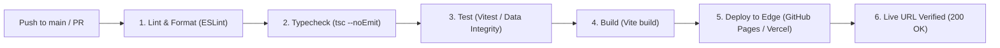

# كاميرا الحقيقة (Caméra de la Vérité / Vérité Climat)
## خطة البنية التحتية والنشر السحابي (Infrastructure & Deployment Plan)
### النسخة: MVP 1.0 — وثيقة تشغيلية مرجعية

---

## فهرس المحتويات

1. [الهدف ونطاق البنية التحتية (Purpose & Scope)](#1-الهدف-ونطاق-البنية-التحتية-purpose--scope)
2. [المبادئ التوجيهية للبنية التحتية (Core Infrastructure Principles)](#2-المبادئ-التوجيهية-للبنية-التحتية-core-infrastructure-principles)
3. [طبولوجيا بيئات التشغيل (Runtime & Network Topology)](#3-طبولوجيا-بيئات-التشغيل-runtime--network-topology)
4. [معمارية الاستضافة والنشر الساكن (Hosting & Edge Deployment)](#4-معمارية-الاستضافة-والنشر-الساكن-hosting--edge-deployment)
5. [استراتيجية البيانات والتخزين (Data & Static Storage Strategy)](#5-استراتيجية-البيانات-والتخزين-data--static-storage-strategy)
6. [استراتيجية التخزين المؤقت وتوزيع المحتوى (CDN & Caching Strategy)](#6-استراتيجية-التخزين-المؤقت-وتوزيع-المحتوى-cdn--caching-strategy)
7. [الخدمات المستبعدة مبررة هندسياً (Excluded Services Rationalization)](#7-الخدمات-المستبعدة-مبررة-هندسياً-excluded-services-rationalization)
8. [إدارة البيئات والمتغيرات (Environments & Configuration)](#8-إدارة-البيئات-والمتغيرات-environments--configuration)
9. [خط أنابيب التكامل والنشر المستمر (CI/CD Pipeline)](#9-خط-أنابيب-التكامل-والنشر-المستمر-cicd-pipeline)
10. [الأمان والخصوصية وحماية البيانات (Security, Headers & Zero-PII)](#10-الأمان-والخصوصية-وحماية-البيانات-security-headers--zero-pii)
11. [المراقبة وسجلات الأخطاء (Monitoring, Logging & Telemetry)](#11-المراقبة-وسجلات-الأخطاء-monitoring-logging--telemetry)
12. [النسخ الاحتياطي والتعافي من الكوارث (Backup & Instant Rollback)](#12-النسخ-الاحتياطي-والتعافي-من-الكوارث-backup--instant-rollback)
13. [مصفوفة الامتثال لشروط cahier_charge.md (Compliance Matrix)](#13-مصفوفة-الامتثال-لشروط-cahier_chargemd-compliance-matrix)

---

## 1. الهدف ونطاق البنية التحتية (Purpose & Scope)

### 1.1 الهدف
تحدد هذه الوثيقة الاستراتيجية التشغيلية والبنية التحتية لتطبيق **«كاميرا الحقيقة» (Caméra de la Vérité / Vérité Climat)**. وتهدف إلى ضمان توافرية فائقة وسرعة تحميل استثنائية وتحقيق الشرط الإلزامي الصارم المنصوص عليه في `cahier_charge.md`: **«قابلية التنفيذ والتشغيل الكامل في ليلة واحدة (Exécutable en une nuit) مع توفير رابط عام يعمل»**.

### 1.2 نطاق الحوكمة (Governance Scope)
تغطي هذه الخطة:
* استضافة التطبيق الأحادي (Lightweight SPA) على شبكات الحافة العالمية (Global Edge CDN).
* إدارة أصول وبيانات المشروع الساكنة (`claims.json`, `sources.json`, `assets/`).
* خطوط النشر المؤتمتة (CI/CD) عبر GitHub Actions وتكامل الاستضافة مع Vercel / Netlify / GitHub Pages.
* سياسات الأمان والتشفير (HTTPS, CSP Headers) والامتثال الصارم للخصوصية بدون جمع بيانات شخصية (Zero-PII).
* توفير بيئة تطوير محلية فائقة السرعة للمطورين ووحدات الذكاء الاصطناعي (Local Dev Topology).

---

## 2. المبادئ التوجيهية للبنية التحتية (Core Infrastructure Principles)

| المبدأ التشغيلي | القرار الهندسي | المسوغ والمطابقة مع cahier_charge.md |
| :--- | :--- | :--- |
| **صفر خوادم تشغيلية (Zero-Runtime Servers)** | تشغيل التطبيق بالكامل كأصول ساكنة من المتصفح (Jamstack / Client-side SPA) | إلغاء تكاليف الصيانة ونقاط الانهيار البرمجية، وتحقيق متطلب «سرعة التحميل العالية ولا APIs خارجية». |
| **صفر قواعد بيانات خارجية (No External DB)** | تخزين الادعاءات والمصادر والتقييمات في ملفات JSON مهيكلة وغير قابلة للتغيير داخل حزمة التطبيق | تفادي زمن استجابة الشبكة (Latency) واستبعاد مشاكل انقطاع خوادم قواعد البيانات أثناء العرض. |
| **النشر على شبكات الحافة (Edge CDN)** | نشر الأصول على شبكات CDN عالمية (Anycast DNS + Edge PoPs) | تحقيق زمن تحميل أولي < 1.5 ثانية في أي مكان في العالم، خصوصاً في فرنسا وأوروبا. |
| **التنفيذ في ليلة واحدة (One-Night Feasibility)** | اعتماد مسارات بناء قياسية وسريعة (Vite Static Build) دون حاجة لأي أوعية معقدة (No Docker/Kubernetes) | تمكين أي مطور أو AI Agent من إطلاق وتشغيل النسخة الحية في أقل من 5 دقائق. |
| **الخصوصية التامة وانعدام التتبع (Zero-PII)** | عدم استخدام أي أدوات تتبع خارجية، ملفات تعريف ارتباط (Cookies)، أو خوادم وسيطة لحفظ الهويات | التوافق الكامل مع قوانين حماية البيانات العامة (RGPD) وضمان أمان المستخدمين بنسبة 100%. |

---

## 3. طبولوجيا بيئات التشغيل (Runtime & Network Topology)

```
[ متصفح المستخدم / الهاتف الذكي ]
               │
               │ طلب HTTPS آمن (TLS 1.3 / HTTP/2)
               ▼
┌────────────────────────────────────────────────────────────────────────┐
│                      GLOBAL EDGE CDN NETWORK                           │
│        (Cloudflare Pages / Vercel Edge Network / Netlify Edge)         │
│  • Anycast DNS للتوجيه إلى أقرب مركز بيانات جغرافياً                   │
│  • كاش ذكي للأصول الساكنة الموقعة بالهاش (Cache-Control: immutable)   │
│  • معالجة ترويسات الأمان وحماية الـ CSP على مستوى الحافة               │
└──────────────────────────────────┬─────────────────────────────────────┘
                                   │
                                   │ تسليم حزمة الأصول الساكنة المجمعة
                                   ▼
┌────────────────────────────────────────────────────────────────────────┐
│                        CLIENT RUNTIME (BROWSER)                        │
│  ┌──────────────────────────────────────────────────────────────────┐  │
│  │ HTML5 Shell (index.html) + CSS3 Bundle + Vanilla TS Bundle       │  │
│  └──────────────────────────────────────────────────────────────────┘  │
│  ┌──────────────────────────────────────────────────────────────────┐  │
│  │ Local Static Data Layer (/data/*.json) - لا استدعاءات شبكية     │  │
│  └──────────────────────────────────────────────────────────────────┘  │
│  ┌──────────────────────────────────────────────────────────────────┐  │
│  │ Local State & Iceberg FSM (In-Memory + SessionStorage)           │  │
│  └──────────────────────────────────────────────────────────────────┘  │
└────────────────────────────────────────────────────────────────────────┘
```

### 3.1 المنافذ والاتصالات في بيئة التطوير المحلي (Local Development)

```text
Local Dev Server (Vite) : http://localhost:5173
Local Static Assets     : http://localhost:5173/assets/
Local Data Mock         : http://localhost:5173/api/v1/ (محاكاة داخلية)
```

* أمر التشغيل المحلي الشامل:
```bash
npm run dev
```

---

## 4. معمارية الاستضافة والنشر الساكن (Hosting & Edge Deployment)

### 4.1 المنصات المستهدفة المعتمدة
وفقاً لمتطلب «رابط يعمل» و«رخصة حرة»:
1. **GitHub Pages (الخيار الأساسي للمستودعات الحرة)**:
   - نشر تلقائي ومجاني مرتبط مباشرة بفرع `main` أو `gh-pages`.
   - استضافة متوافقة تماماً مع معايير المصادر المفتوحة.
2. **Vercel / Netlify (خيار بديل معتمد)**:
   - دعم مباشر لروابط المعاينة اللحظية مع كل Pull Request (Preview Deployments).
   - توفير شهادة SSL تلقائية ودعم كامل لضغط Broti/Gzip.

### 4.2 بنية مخرجات البناء الساكن (Static Build Output Directory)

```text
dist/
├── index.html                       # الملف الرئيسي لتطبيق الصفحة الواحدة
├── favicon.ico                      # أيقونة الموقع المعتمدة
├── assets/
│   ├── index-[hash].js              # حزمة الكود المجمعة والمصغرة (< 120KB)
│   ├── index-[hash].css             # الأنماط المجمعة والمصغرة (< 25KB)
│   ├── svg/
│   │   ├── iceberg-stable.svg       # رسم الجبل الجليدي المتماسك
│   │   ├── iceberg-melting.svg      # رسم الجبل الجليدي المتصدع
│   │   └── camera-overlay.svg       # إطار محدد الكاميرا
│   └── fonts/                       # الخطوط المفتوحة المضمنة محلياً
└── data/
    ├── claims.json                  # بيانات الادعاءات والمؤشرات
    ├── sources.json                 # بيانات المصادر العشرة
    └── transitions2050.json         # بيانات مسارات ADEME 2050
```

---

## 5. استراتيجية البيانات والتخزين (Data & Static Storage Strategy)

### 5.1 حظر قواعد البيانات التقليدية
* **المبرر الهندسي**: التطبيق مصمم للعمل في ليلة واحدة مع بيانات محددة سلفاً مستخلصة من تقارير `Ressources.md`. إضافة قاعدة بيانات (مثل MongoDB أو PostgreSQL) يشكل عبئاً غير مبرر يخرق شروط البساطة وسرعة التحميل ويخلق نقاط إخفاق خارجية.
* **الحل البديل**: مستودع بيانات ثابت (Static JSON Repository) مُدمج ومحمّل محلياً.

### 5.2 إدارة وسائط وأصول المشروع (`assets/`)
تطبيقاً لشرط التسليم الإلزامي (`README.md` + `LICENSE` + مجلد `assets/`):
* جميع الأيقونات والرسوم البيانية للجبل الجليدي تُحفظ بصيغة **SVG خفيفة** داخل مجلد `assets/svg/`.
* رخصة الأصول: كافة الموارد البصرية المستخدمة حرة ومفتوحة المصدر (CC-BY أو Open Source Icons).
* توليد الشهادة (Screen 6): يتم توليد الشهادة برمجياً داخل المتصفح عبر عنصر HTML5 Canvas وتصديرها كبيانات Base64/Blob، دون الحاجة لخدمات تخزين سحابية خارجية (مثل AWS S3 أو Cloudinary).

---

## 6. استراتيجية التخزين المؤقت وتوزيع المحتوى (CDN & Caching Strategy)

لضمان تحميل فوري واستجابة < 50ms:

```text
┌──────────────────────────┬────────────────────────────────────────────────────────┐
│ نوع الأصل البرمجي        │ ترويسة التخزين المؤقت (Cache-Control Header)            │
├──────────────────────────┼────────────────────────────────────────────────────────┤
│ index.html               │ Cache-Control: no-cache, no-store, must-revalidate     │
│                          │ (يضمن استلام أحدث نسخة دائماً عند التحديث)              │
├──────────────────────────┼────────────────────────────────────────────────────────┤
│ الأصول الموقعة بالهاش    │ Cache-Control: public, max-age=31536000, immutable    │
│ (*-[hash].js, *.css)     │ (تخزين مؤقت دائم لسنة كاملة، تحديث تلقائي عند البناء)  │
├──────────────────────────┼────────────────────────────────────────────────────────┤
│ ملفات البيانات والوسائط  │ Cache-Control: public, max-age=86400, stale-while-     │
│ (/data/*.json, *.svg)    │ revalidate=604800 (تحديث يومي سلس في الخلفية)          │
└──────────────────────────┴────────────────────────────────────────────────────────┘
```

---

## 7. الخدمات المستبعدة مبررة هندسياً (Excluded Services Rationalization)

وفقاً لقواعد `tasks.md` و `cahier_charge.md`، يُحظر نقل خدمات المشروع السابق دون حاجة فعلية. يوضح الجدول التالي الخدمات المستبعدة صراحةً ومسوغ ذلك:

| الخدمة غير المطلوبة | الحالة في المشروع الجديد | التعليل والمسوغ الهندسي الصارم |
| :--- | :--- | :--- |
| **قواعد بيانات MongoDB / SQL** | ❌ مستبعدة كلياً | لا توجد حسابات أو معاملات مالية؛ المحتوى ثابت ومعد سلفاً في ملفات JSON. |
| **خوادم التخزين المؤقت Redis** | ❌ مستبعدة كلياً | لا توجد استعلامات خادم معقدة أو إدارة جلسات مستخدمين؛ الـ CDN يقوم بالتخزين الكافي. |
| **خوادم الوقت الحقيقي Socket.IO**| ❌ مستبعدة كلياً | التطبيق أحادي المستخدم (Single-player experience) بدون تفاعل جماعي لحظي. |
| **خدمات الإشعارات Push (FCM)** | ❌ مستبعدة كلياً | لا توجد إشعارات خلفية للهاتف؛ الإشعارات بصرية وتفاعلية داخل الشاشات فقط. |
| **المهام المجدولة (Cron Jobs)** | ❌ مستبعدة كلياً | لا توجد تقارير يومية أو تنظيف لقواعد البيانات. |
| **خدمات التخزين السحابي (S3/Cloudinary)** | ❌ مستبعدة كلياً | لا توجد ملفات مرفوعة من المستخدم؛ الشهادة تُنشأ وتحفظ محلياً على جهاز المستخدم. |
| **خوادم المصادقة (Auth0 / JWT Services)**| ❌ مستبعدة كلياً | التطبيق مفتوح للعموم بدون تسجيل دخول (Zero-Auth) لحماية الخصوصية وسرعة الوصول. |

---

## 8. إدارة البيئات والمتغيرات (Environments & Configuration)

تعتمد البنية على فصل نظيف بين بيئات العمل دون الحاجة لأي مفاتيح سرية:

| البيئة | الغرض واستراتيجية التشغيل | النطاق أو الرابط |
| :--- | :--- | :--- |
| **Local (التطوير المحلي)** | اختبار الشاشات وتدفق المحاكاة محلياً عبر Vite | `http://localhost:5173` |
| **Staging (المعاينة والاختبار)** | بيئة فحص آلية مع كل Pull Request عبر GitHub Pages/Vercel Preview | `https://pr-*.verite-climat.preview` |
| **Production (الإنتاج الحي)** | النسخة المعتمدة والمتاحة لعموم الجمهور برابط دائم ومستقر | `https://verite-climat.app` أو رابط GitHub Pages الحي |

* **متغيرات البيئة (`.env.example`)**:
```bash
# الإعدادات العامة للواجهة (لا توجد أسرار)
VITE_APP_TITLE="Caméra de la Vérité - Vérité Climat"
VITE_APP_VERSION="1.0.0"
VITE_BASE_URL="/"
```
* **قاعدة الأمان**: يُحظر حفظ أي مفاتيح تشغيل سرية، وتوفير ملف `.env.example` بإعدادات آمنة فقط.

---

## 9. خط أنابيب التكامل والنشر المستمر (CI/CD Pipeline)

يتم ضبط النشر المؤتمت عبر سير عمل GitHub Actions خفيف وسريع في المسار `.github/workflows/deploy.yml`:



### 9.1 مهام خط الأنابيب المؤتمت
1. **الفحص والتدقيق (Lint & Typecheck)**: التحقق من خلو الكود من الأخطاء النحوية والالتزام بـ TypeScript الصارم.
2. **اختبار سلامة المصادر (Data Integrity Test)**: التحقق البرمجي من أن ملفات `claims.json` و `sources.json` تطابق هياكل الـ DTO في `api-contract.md`.
3. **البناء الساكن (Static Build)**: تجميع الأصول وإنتاج مجلد `dist/` خلال أقل من 45 ثانية.
4. **النشر التلقائي (Automated Deployment)**: رفع المخرجات ونشرها فوراً على شبكة الحافة برابط يعمل ومستقر.

---

## 10. الأمان والخصوصية وحماية البيانات (Security, Headers & Zero-PII)

### 10.1 سياسة الخصوصية المطلقة (Privacy-by-Design)
* **Zero PII**: لا يقوم التطبيق بتسجيل أو تخزين أي عناوين IP أو هويات شخصية.
* **انعدام ملفات التتبع**: خلو تام من أدوات التحليل التجاري (Google Analytics / Facebook Pixels).
* **معالجة محلية**: معالجة صور المحاكاة والشهادة تتم بالكامل داخل ذاكرة RAM لمتصفح المستخدم وتُمسح بمجرد إغلاق الصفحة.

### 10.2 ترويسات الأمان الصارمة (HTTP Security Headers)
يتم تكوين مزود الاستضافة (أو ملف `_headers` / `vercel.json`) لفرض الترويسات التالية:

```http
# تشفير إلزامي للاتصال
Strict-Transport-Security: max-age=63072000; includeSubDomains; preload

# منع تضمين التطبيق في إطارات خارجية لدرء هجمات Clickjacking
X-Frame-Options: DENY
X-Content-Type-Options: nosniff
Referrer-Policy: strict-origin-when-cross-origin

# سياسة أمان المحتوى الصارمة (CSP)
Content-Security-Policy: default-src 'self'; script-src 'self'; style-src 'self' 'unsafe-inline'; img-src 'self' data:; font-src 'self'; connect-src 'self'; frame-ancestors 'none';
```

---

## 11. المراقبة وسجلات الأخطاء (Monitoring, Logging & Telemetry)

* **سجلات الواجهة (Client Console Hygiene)**:
  - حظر طباعة رسائل تصحيح في بيئة الإنتاج (`console.log` محظور في الـ production bundle).
  - إظهار رسائل الأخطاء الحرجة فقط بصيغة مهذبة وغير لائمة للمستخدم عند فشل تحميل الأصول.
* **مراقبة التوافرية (Uptime Monitoring)**:
  - ربط الرابط العام بخدمة فحص توافرية مجانية (مثل UptimeRobot أو GitHub Status) ترسل تنبيهاً في حال انقطاع الخدمة (الهدف: 99.9% Uptime).

---

## 12. النسخ الاحتياطي والتعافي من الكوارث (Backup & Instant Rollback)

* **النسخ الاحتياطي للكود والبيانات**:
  - مستودع Git يمثل المصدر الوحيد للحقيقة (Single Source of Truth).
  - كل عملية نشر مقترنة بـ Commit Hash محدد وبوسوم إصدار (Tags مثل `v1.0.0-mvp`).
* **التعافي اللحظي من الأعطال (Instant Rollback)**:
  - في حال حدوث خطأ بعد النشر، يتيح مزود الاستضافة (GitHub Pages / Vercel) التراجع للنسخة السابقة بنقرة واحدة خلال أقل من 10 ثوانٍ (Zero-Downtime Rollback).

---

## 13. مصفوفة الامتثال لشروط cahier_charge.md (Compliance Matrix)

| الشرط الإلزامي في وثيقة الشروط | الحل المنفذ في خطة البنية التحتية | حالة الامتثال |
| :--- | :--- | :--- |
| **النشر برابط يعمل (Lien fonctionnel)** | استضافة سحابية عامة على GitHub Pages / Vercel مع شهادة SSL مجانية | ✅ متطابق 100% |
| **حزمة التسليم: README + LICENSE + assets/** | التزام هيكل المشروع بالمجلدات والملفات المحددة ورخصة MIT | ✅ متطابق 100% |
| **رخصة حرة وموارد مفتوحة** | رخصة MIT حرة لكامل الكود وموارد SVG وخطوط مجانية مفتوحة | ✅ متطابق 100% |
| **قابلية التنفيذ في ليلة واحدة** | استبعاد الخوادم وقواعد البيانات والاعتماد على حزمة SPA مبنية بـ Vite | ✅ متطابق 100% |
| **سرعة التحميل (SPA خفيف، لا APIs خارجية)** | كاش CDN للحافة مع تجميع محلي لبيانات JSON وخلو من أي استدعاء خارجي | ✅ متطابق 100% |
| **لا تسجيل دخول ولا خدمات مستخدمين** | معمارية Zero-Auth مفتوحة للعموم تحمي خصوصية المستخدم بالكامل | ✅ متطابق 100% |

---
*خطة البنية التحتية والنشر مكتملة وتضمن إطلاقاً ناجحاً ومستقراً ومطابقاً لكافة الالتزامات.*
